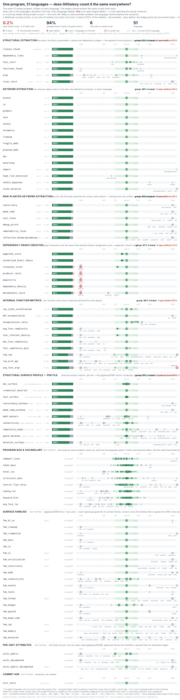

# Cross-Language Bias Report

Generated by `tools/bias_report.py` over 56 locked language(s): abap, acs, ada, agc_assembly, apex, assembly, bms, c, cobol, cpp, crystal, csharp, css, dart, db2_sql, dockerfile, embedded_python, fortran, fsharp, go, groovy, haskell, hlasm, html, java, javascript, jcl, kotlin, livecode, lua, m4, makefile, markdown, matlab, objective-c, perl, php, pli, postgresql, powershell, python, rexx, ruby, rust, scala, scheme, shell, solidity, sqlite, swift, tcl, typescript, yacc, yaml, zig, zscript.

**Engine mode: full precision** — all six optional dependencies present, so the network metrics (pagerank) are live.

Planted intent is identical in every language (SPEC.md probe table), so any column-to-column divergence below is measured language bias — an extraction inequality or a scoring inequality. Every known deviation is validated in `deviation_ledger.json`; see per-language `expected_signals.json` notes for the shape-by-shape accounting.

**n/a semantics:** 55 language/signal cells are marked n/a — the language's registry entry defines no rule for that signal, so the engine cannot ever report a nonzero there. Those cells are *incomparable*, not zero: they are excluded from medians, deviation bands, and consistency scores rather than counted as −100% divergence. An n/a does **not** certify the absence is correct — that takes a validated ledger entry (docs/GATING.md).

**Derived metrics:** a further 19 cells are n/a in the `risk_*` columns. Those are formulas over the same signals, so a language whose every governed input is absent has a structurally pinned score, not a low one — it used to be scored as a −100% outlier against languages that actually measured something. The inputs are read live off the engine's risk assembly, and a derived cell qualifies only when its formula reads no engine-synthesized input **and** the scan confirms the observed value is 0 (rule absence alone is not enough: these formulas also read structure the registry does not govern — LOC, doc lines, the call graph, popularity). Its review status is inherited, not invented: it counts as ledgered only when every governed input is itself ledgered for that language.

**Structure counts:** and 9 cells are n/a in the STRUCTURE COUNTS group (gitgalaxy#2795). These columns read the engine's own `function_count`/`class_count`/`import_count` rather than a registry rule, so the rule-absence inference above never reached them and a language could be n/a on `func_start` and a −100% outlier on `functions_found` in the same report — the group's consistency scores were measured over a larger population than the rules they summarise. Each count now names the rule it is a tally of and inherits that rule's review status. `dependency_links` is governed by `_dependency_capture`, **not** by `import`: since gitgalaxy#2638 the two diverge, and markdown records 3 real edges with no `import` rule — a comparable cell that stays scored. A governing rule can also be present and govern nothing (gitgalaxy#2792): sqlite is sliced by Mode E, which never consults `func_start` for a name — it labels every bucket after the igniter keyword — so the language has no function population at all. That cell is reviewed by an entry naming the count itself, not inherited from a rule whose presence says nothing about what its matches mean.

**Registry/engine mismatches** (left comparable, never absorbed): every registry input to these cells is absent, yet the engine still measured a value — so either the derived dependency map is incomplete, or the input is synthesized downstream of the registry the way orphan conversion synthesizes `api` (ledger `api-contextual-baseline-fix`): `acs/risk_verification` = 2.377, `bms/risk_verification` = 2.363, `zscript/risk_verification` = 2.374.

## Out-of-band cells: explained vs. unexplained

An out-of-band cell is not automatically a defect. Three mechanisms account for one without anything being wrong with the engine, and the epic's close criterion is that nothing survives all three (`--gate` exits nonzero while anything does). The four program-length columns are context, not consistency claims, and are not counted here at all (69 of their cells are out of band; see the next section).

| verdict | cells | meaning |
|---|---|---|
| undefined | 15 | a per-function descriptor for a language with no functions -- the quotient has no value, it is not a deviation |
| ledgered | 116 | a validated deviation-ledger entry names this language and this metric |
| derived | 43 | a composite whose deviation entered through an input that is itself out of band, so it is the same finding counted twice |
| **unexplained** | **32** | **survived all three -- the real work remaining** |

Unexplained cells, by metric:

- `avg_func_args` — db2_sql, postgresql
- `betweenness_score` — crystal, fsharp, go, rust, swift
- `closeness_score` — fsharp, go, rust, swift
- `concurrency` — acs
- `dependency_density` — go, rust, swift
- `popularity` — fsharp, go, rust, swift
- `producer_ratio` — fsharp, go, rust, swift
- `raw_arch_api` — postgresql
- `risk_safety_score` — acs, zscript
- `risk_state_flux` — postgresql
- `risk_tech_debt` — agc_assembly, fsharp, postgresql, yacc
- `state_mutation` — crystal

## What the red cells are

A verdict says a cell is accounted for; it does not say what the cell *is*, and the consistency badges above paint a validated "this language cannot express that" the same red as an open engine defect. Folding each ledgered cell's dispositions into one cause (most severe first where an entry list mixes them) gives the split that the badge cannot: how much of the red is a finding somebody still owes. The **open-defect share** counts `unexplained`, `extraction` and `correlation` cells over every comparable cell of the gated metrics; scoring choices are ledgered design, inherency and echo are not findings at all. Cause categories, the roadmap they come from and what each one's right response is: gitgalaxy `docs/contract_roadmap.md`.

**Open-defect share: 33 of 3125 comparable cells (1.1%)** across 58 gated metrics; 33 of the 206 out-of-band cells are open defects.

| cause | cells | what it is |
|---|---|---|
| **unexplained** | 32 | survived every mechanism -- the gate fails on these |
| **extraction** | 1 | a rule matches the wrong construct, or two rules claim one token (upstream-bug, upstream-question, engine-defect, keyword-overlap) |
| **correlation** | 0 | a proximity pair in spatial_correlation.py used to edit the recorded count (the x3 cascading flux, the silencer dampener); since gitgalaxy#2815 (Phase 2) they are tallies applied only in the score layer's weighted view |
| scoring | 55 | a deliberate engine choice in a formula or a path modifier (engine-semantic) |
| inherency | 75 | the best the language can do: intended-morphology, or a per-function descriptor where the language has no functions |
| echo | 43 | derived -- an upstream deviation counted again downstream |

Metrics carrying the most open defect, by share of their comparable cells:

- `betweenness_score` — 5 of 56 (9%)
- `risk_tech_debt` — 4 of 56 (7%)
- `producer_ratio` — 4 of 56 (7%)
- `popularity` — 4 of 56 (7%)
- `closeness_score` — 4 of 56 (7%)

Ledger entries that currently explain **no** out-of-band cell (validated, still reproducing, but their signal x language cross-product lands entirely in band — keyword-rosetta#75's decay check): `api-contextual-baseline-fix`, `asm-single-letter-mnemonic-in-path`, `haskell-caf-bindings-count-as-functions`, `batch4-dual-keyword-overlaps`, `comment-lines-manifest-doc-classification`, `units-public-main-outside-api-contract`, `secrets-lens-inert-formats`, `fsharp-nested-block-comment-not-stripped`, `fsharp-juxtaposed-call-invisible`, `fsharp-open-module-not-resolved-to-file`. Narrow or retire them.

## The language-level risk constant is design; the report bands within it

`analysis_lens.LANGUAGE_STRICTNESS` gives every language four yes/no columns (static types, enforced errors, memory safety, no implicit globals) and `strictness_constants()` turns the count of `False` columns into the constants the formulas below read: `Irc` = gaps, `Ot` = 1 + 0.1 x gaps (gitgalaxy#2718, which replaced the three hand-listed scoring tiers this section used to read out of `signal_processor._get_tier`). Wiki 08-03 documents the term as deliberate. Against a global median it reads as bias: languages carrying the same gap count report identical risk values with inputs identical to the median language. So each metric that reads a language-level constant is banded against **the median of its own stratum** (gitgalaxy#2669 F.3), and the per-stratum medians are the documented offset, printed here rather than hidden. Which metrics read one is taken off the engine source at regen time, never hand-listed. Strata (`ircN` = N strictness gaps): **irc0** = abap, acs, ada, agc_assembly, apex, assembly, c, cobol, cpp, crystal, csharp, dart, db2_sql, dockerfile, embedded_python, fortran, fsharp, go, groovy, haskell, hlasm, java, javascript, jcl, kotlin, livecode, lua, m4, makefile, matlab, objective-c, perl, php, pli, postgresql, powershell, python, rexx, ruby, rust, scala, scheme, shell, solidity, sqlite, swift, tcl, typescript, yacc, zig, zscript; **unprofiled** = bms, css, html, markdown, yaml.

**Not held equal:** the per-language x per-signal fidelity coefficients (`gitgalaxy/standards/fidelity_table.py`) that replaced the scalar `fc`. They are generated FROM this corpus, so banding against them would be circular -- a surviving defence-credit deviation may still be a fidelity cell.

| metric | irc0 median (n) | unprofiled median (n) | global median |
|---|---|---|---|
| `risk_cognitive_load` | 1.295 (51) | 1.190 (3) | 1.295 |
| `risk_safety_score` | 30.583 (51) | 30.308 (3) | 30.583 |
| `risk_tech_debt` | 29.878 (51) | 20.439 (5) | 29.878 |
| `risk_verification` | 2.380 (51) | 2.359 (4) | 2.380 |

## Non-planted keyword extraction

The risk formulas read registry signals the SPEC does not plant: `concurrency`, `dead_code`, `debug_prints`, `immutability_locks`, `llm_api`, `reflection_metaprogramming`, `sync_locks`. Nothing in the corpus was written for these rules to match, so the honest reading is **0 in every language** and any nonzero cell is a rule matching a token the program carries for some other reason. That is a comparable claim, so since 2026-09-07 the group is **scored** (on exact agreement against the zero median, the basis every zero-median metric uses) rather than charted as context next to program length. Each nonzero cell needs a verdict like any other: the sweep that turned the scoring on audited all 37 by running each language's own rule over its code and comment streams, and they resolve to the language's mandatory form (a JavaScript declaration cannot avoid `const`), a token planted for another signal and counted again here (`eval` is the high_risk_execution plant), or a signal the SPEC does plant in a language or two without giving it a manifest column (`[SPEC-2732]`) -- all ledgered as `non-planted-rules-match-idiom-and-planted-tokens`, with the one real defect it found split out as `makefile-dead-code-reads-prose-labels` (gitgalaxy#2851). 30 cells are out of band now:

- `concurrency` — acs 3, agc_assembly 1, swift 1
- `dead_code` — bms 1, hlasm 1, jcl 1, rexx 1
- `debug_prints` — abap 5, cobol 7, dockerfile 2, scheme 2, yaml 2
- `immutability_locks` — c 1, cpp 1, fortran 1, html 1, php 1, ruby 1
- `reflection_metaprogramming` — apex 3, fortran 2, html 2, makefile 1, powershell 1, shell 2, solidity 1, yacc 4
- `sync_locks` — agc_assembly 2, jcl 1, solidity 1, zig 1

`risk_stability` and `risk_churn` read commit age, not content, and are reported as temporal context on the same terms.

## Program length is context, and the x-axis of the leak check

`total_loc`, `coding_loc`, `token_mass`, `keyword_hits`, `avg_func_loc`, `comment_lines` measure how long each language's 12-probe program came out, which the SPEC does not plant (gitgalaxy#2669 F.1): a 12-probe Dockerfile cannot be as long as the Java one without padding, and padding would move the planted signals. They are charted without a badge, excluded from the consistency average, and never gated. A context column that is out of band for a language can still explain a derived cell there (`derived: inherits coding_loc` is a deviation that entered through length), and `coding_loc` is the x-axis of the check below.

**Length leaks.** For each derived metric, over the languages whose measured inputs for it are all in band (content held equal, so length is the only free variable), the Spearman rank correlation against `coding_loc`. |rho| ≥ 0.6 across ≥ 8 languages is a **leak**: the formula reads length where it should read content. That is one finding per formula, not one per language — each is an engine design question in the gitgalaxy#2655 shape, filed against the cited line — and it changes no cell's verdict above. The engine's language-level constant (gitgalaxy#2653/#2718: a flat `Irc / mass_loc` term and an `Ot` scale) is held equal as well, inside the largest strictness stratum among the qualifying languages, because the high-gap languages are largely the short shells and a strictness effect would otherwise read as a length effect. A metric with no known inputs is correlated over every language that records it (nothing held), which is weaker evidence and is marked as such. A per-unit ratio (gitgalaxy#2908: `risk_documentation`) is a pure function of its held inputs, so those are held EXACTLY rather than banded -- languages sharing the modal unit profile must score identically, and a constant score there is printed as **invariant**: the formula cannot read length, by measurement.

| metric | languages | stratum | rho | verdict | inputs held in band | where length enters |
|---|---|---|---|---|---|---|
| `risk_secrets_risk` | 44 | irc0 | -0.90 | **leak** | `dead_code`, `debug_prints`, `globals`, `llm_api` | **not located yet** — the more interesting finding |
| `risk_verification` | 48 | irc0 | +0.57 | weak | `high_risk_execution` | _calc_verification: untested impact / _mass_loc(loc) (signal_processor.py ~L1664) -- same floor, same constant denominator |
| `risk_documentation` | 16 | — | +0.00 | invariant — the proof | `reflection_metaprogramming`, `functions_found`, `units_documented`, `units_public`, `units_public_documented` *(held exactly)* | no LOC term since gitgalaxy#2908 Phase 3: a pure per-unit coverage ratio (signal_processor.py `_calc_documentation`), constant across languages sharing the held unit profile -- the rho -0.83 leak this row used to carry is resolved by construction; variation between profiles is main's units_public/units_documented split, the api contract cells |

## Cross-language variance chart

Colour encodes **cause**, not magnitude: a dot inside ±25% of the cross-language median is green; outside it, **red** when the cell is an open engine defect (`unexplained`, `extraction`, `correlation` in the cause table above) and **grey** when it is a documented variation (a scoring choice, language inherency, or an echo of another row). Each gated row's bar splits its languages the same way — in band · documented · open defect — with the **accounted share** printed inside (in band + documented: everything that is not an open defect — a documented variation is measured and explained, so it does not subtract from the badge) and the open-defect count after it; the in-band count keeps its n/n label in the band's corner, and languages at the same position collapse into one dot carrying their count, so exact agreement is visible instead of overplotted. Rows run best → worst (least open defect first). The header's first number is the open-defect share, the number to drive to 0. Average share in band across 54 gated metrics: **93%**; 50 metrics hold ≥80% of languages in band. Weakest by in-band share: raw_arch_api 73%, cog_raw 75%, risk_safety_score 80%, risk_state_flux 80%, avg_func_args 80%. *exact* marks a metric scored on **exact agreement** with a zero median (relative deviation is undefined there, so the score is the share of languages sitting exactly on it): class_start, concurrency, dead_code, debug_prints, immutability_locks, reflection_metaprogramming, sync_locks, def_encapsulation, risk_concurrency, risk_dead_code, fam_concurrency, fam_ipc, fam_memory, fam_ml_ai, fam_serialization, fam_ui, units_public_documented. **Inert** (every language records exactly 0, so the column asks no cross-language question — scored as no result rather than as unanimous agreement): llm_api, state_slop_duplicates, risk_spec_match, fam_crypto, fam_regex, fam_threat, fam_time, risk_churn. Not-gated groups (program size & vocabulary, commit age) are drawn for context and never scored: languages vary too much in how they express these for a cross-language band to mean anything. Non-planted keyword extraction is NOT one of them -- nothing was written for those rules to match, so 0 everywhere is a comparable expectation and the group is scored against it. `pagerank` is not drawn (identical to pagerank_score).

## Planted keyword signals (corpus totals vs. planted intent)

| signal | planted | abap | acs | ada | agc_assembly | apex | assembly | bms | c | cobol | cpp | crystal | csharp | css | dart | db2_sql | dockerfile | embedded_python | fortran | fsharp | go | groovy | haskell | hlasm | html | java | javascript | jcl | kotlin | livecode | lua | m4 | makefile | markdown | matlab | objective-c | perl | php | pli | postgresql | powershell | python | rexx | ruby | rust | scala | scheme | shell | solidity | sqlite | swift | tcl | typescript | yacc | yaml | zig | zscript |
|---|---|---|---|---|---|---|---|---|---|---|---|---|---|---|---|---|---|---|---|---|---|---|---|---|---|---|---|---|---|---|---|---|---|---|---|---|---|---|---|---|---|---|---|---|---|---|---|---|---|---|---|---|---|---|---|---|---|
| branch | 3 | 3 | 3 | 3 | 3 | 3 | 3 | n/a | 3 | 3 | 3 | 3 | 3 | 3 | 3 | 3 | 3 | 3 | 3 | 3 | 3 | 3 | 3 | 3 | 3 | 3 | 3 | 3 | 3 | 3 | 3 | 3 | 3 | n/a | 3 | 3 | 3 | 3 | 3 | 3 | 3 | 3 | 3 | 3 | 3 | 3 | 3 | 3 | 3 | 3 | 3 | 3 | 3 | 3 | 3 | 3 | 3 |
| io | 3 | 3 | 3 | 3 | 3 | 3 | 3 | n/a | 3 | 3 | 3 | 3 | 3 | 3 | 3 | 3 | 3 | 3 | 3 | 3 | 3 | 3 | 3 | 3 | 3 | 3 | 3 | 3 | 3 | 3 | 3 | 3 | 3 | n/a | 3 | 3 | 3 | 3 | 3 | 3 | 3 | 3 | 3 | 3 | 3 | 3 | 3 | 3 | n/a | 3 | 3 | 3 | 3 | 3 | 3 | 3 | 3 |
| high_risk_execution ⚠ | 2 | 3 | n/a | 3 | 2 | 3 | 3 | n/a | 3 | 3 | 3 | 3 | 3 | 3 | 3 | 3 | 3 | 3 | 3 | 3 | 3 | 3 | 3 | 3 | 3 | 3 | 3 | 3 | 3 | 3 | 3 | 3 | 3 | n/a | 3 | 3 | 3 | 3 | 3 | 3 | 3 | 3 | 3 | 3 | 3 | 3 | 3 | 3 | 3 | 3 | 3 | 3 | 3 | 3 | 3 | 3 | n/a |
| globals | 2 | 2 | 2 | 2 | 2 | 2 | 2 | n/a | 2 | 2 | 2 | 2 | 2 | 2 | 2 | 2 | 2 | 2 | 2 | 2 | 2 | 2 | 2 | 2 | n/a | 2 | 2 | 2 | 2 | 2 | 2 | 2 | 2 | n/a | 2 | 2 | 2 | 2 | 2 | 2 | 2 | 2 | 2 | 2 | 2 | 2 | 2 | 2 | 2 | 2 | 2 | 2 | 2 | 2 | 2 | 2 | 2 |
| test | 2 | 2 | n/a | 2 | 2 | 2 | 2 | n/a | 2 | 2 | 2 | 2 | 2 | 2 | 2 | 2 | 2 | 2 | 2 | 2 | 2 | 2 | 2 | n/a | 2 | 2 | 2 | n/a | 2 | 2 | 2 | 2 | 2 | n/a | 2 | 2 | 2 | 2 | 2 | 2 | 2 | 2 | n/a | 2 | 2 | 2 | 2 | 2 | 2 | 2 | 2 | 2 | 2 | n/a | 2 | 2 | n/a |
| safety | 2 | 2 | 2 | 2 | 2 | 2 | 2 | n/a | 2 | 2 | 2 | 2 | 2 | 2 | 2 | 2 | 2 | 2 | 2 | 2 | 2 | 2 | 2 | 2 | 2 | 2 | 2 | 2 | 2 | 2 | 2 | 2 | 2 | n/a | 2 | 2 | 2 | 2 | 2 | 2 | 2 | 2 | 2 | 2 | 2 | 2 | 2 | 2 | 2 | 2 | 2 | 2 | 2 | 2 | 2 | 2 | 2 |
| safety_bypasses ⚠ | 2 | 2 | n/a | 2 | 2 | 2 | 2 | n/a | 2 | 2 | 2 | 2 | 2 | 2 | 2 | 2 | 2 | 2 | 3 | 2 | 2 | 2 | 4 | 2 | 2 | 2 | 2 | 2 | 2 | 2 | 2 | 2 | 2 | n/a | 2 | 2 | 2 | 2 | 2 | 2 | 2 | 2 | 2 | 2 | 2 | 2 | 2 | 2 | 2 | 2 | 2 | 2 | 2 | 2 | 2 | 2 | 2 |
| telemetry | 2 | 2 | n/a | 2 | 2 | 2 | 2 | n/a | 2 | 2 | 2 | 2 | 2 | n/a | 2 | 2 | 2 | 2 | 2 | 2 | 2 | 2 | 2 | 2 | 2 | 2 | 2 | 2 | 2 | 2 | 2 | 2 | 2 | n/a | 2 | 2 | 2 | 2 | 2 | 2 | 2 | 2 | 2 | 2 | 2 | 2 | 2 | 2 | 2 | 2 | 2 | 2 | 2 | 2 | 2 | 2 | n/a |
| state_mutation ⚠ | 2 | 2 | 2 | 2 | 2 | 2 | 2 | n/a | 2 | 2 | 2 | 9 | 2 | n/a | 2 | 2 | 2 | 15 | 2 | 2 | 2 | 2 | 2 | 2 | n/a | 2 | 2 | 2 | 2 | 2 | 2 | 2 | 2 | n/a | 2 | 2 | 2 | 2 | 2 | 2 | 2 | 21 | 2 | 11 | 2 | 2 | 2 | 2 | 2 | 2 | 2 | 2 | 2 | 2 | 2 | 2 | 2 |
| cleanup | 2 | 2 | 2 | 2 | 2 | 2 | 2 | n/a | 2 | 2 | 2 | 2 | 2 | n/a | 2 | 2 | 2 | 2 | 2 | 2 | 2 | 2 | 2 | 2 | 2 | 2 | 2 | 2 | 2 | 2 | 2 | 2 | 2 | n/a | 2 | 2 | 2 | 2 | 2 | 2 | 2 | 2 | 2 | 2 | 2 | 2 | 2 | 2 | 2 | 2 | 2 | 2 | 2 | 2 | 2 | 2 | 2 |
| fragile_debt | 1 | 1 | 1 | 1 | 1 | 1 | 1 | 1 | 1 | 1 | 1 | 1 | 1 | 1 | 1 | 1 | 1 | 1 | 1 | 1 | 1 | 1 | 1 | 1 | 1 | 1 | 1 | 1 | 1 | 1 | 1 | 1 | 1 | n/a | 1 | 1 | 1 | 1 | 1 | 1 | 1 | 1 | 1 | 1 | 1 | 1 | 1 | 1 | 1 | 1 | 1 | 1 | 1 | 1 | 1 | 1 | 1 |
| planned_debt | 1 | 1 | 1 | 1 | 1 | 1 | 1 | 1 | 1 | 1 | 1 | 1 | 1 | 1 | 1 | 1 | 1 | 1 | 1 | 1 | 1 | 1 | 1 | 1 | 1 | 1 | 1 | 1 | 1 | 1 | 1 | 1 | 1 | n/a | 1 | 1 | 1 | 1 | 1 | 1 | 1 | 1 | 1 | 1 | 1 | 1 | 1 | 1 | 1 | 1 | 1 | 1 | 1 | 1 | 1 | 1 | 1 |
| import ⚠ | 3 | 3 | 3 | 3 | 3 | 3 | 3 | 3 | 3 | 3 | 3 | 3 | 3 | 3 | 3 | 3 | 3 | 7 | 3 | 3 | 3 | 3 | 3 | 3 | 3 | 3 | 3 | 3 | 3 | 3 | 3 | 3 | 3 | n/a | 3 | 3 | 3 | 3 | 3 | 3 | 3 | 3 | 3 | 3 | 3 | 3 | 3 | 3 | 3 | 3 | 3 | 3 | 3 | 3 | 3 | 3 | 3 |
| func_start ⚠ | 13 | 13 | 13 | 13 | 13 | 13 | 13 | 13 | 13 | 13 | 13 | 13 | 13 | 14 | 13 | 13 | 17 | 13 | 13 | 13 | 13 | 13 | 15 | 14 | 9 | 13 | 13 | 13 | 13 | 13 | 13 | 13 | 14 | n/a | 13 | 13 | 13 | 13 | 13 | 13 | 13 | 13 | 13 | 13 | 13 | 13 | 13 | 13 | 13 | 13 | 13 | 13 | 13 | 13 | 13 | 13 | 13 |
| args ⚠ | 13 | 13 | 13 | 13 | 13 | 13 | 13 | 13 | 13 | 10 | 13 | 13 | 13 | n/a | 13 | 13 | 4 | 13 | 13 | 13 | 13 | 13 | 15 | 1 | 3 | 13 | 13 | 13 | 13 | 13 | 13 | 20 | 1 | n/a | 13 | 13 | 13 | 13 | 13 | 13 | 13 | 13 | 13 | 13 | 13 | 13 | 13 | 13 | 13 | 1 | 13 | 13 | 13 | 2 | 13 | 13 | 13 |
| class_start ⚠ | 0 | 0 | n/a | 0 | n/a | 0 | 0 | 1 | 0 | 1 | 0 | 0 | 0 | 1 | 0 | 0 | 4 | 0 | 0 | 0 | 0 | 0 | 0 | 0 | 0 | 0 | 0 | 1 | 2 | 0 | 0 | n/a | n/a | n/a | 0 | 0 | 0 | 0 | 0 | 0 | 0 | 0 | 0 | 0 | 0 | 0 | 0 | n/a | 0 | 0 | 0 | 0 | 0 | 0 | 7 | 0 | 0 |
| doc | 1 | 1 | n/a | 1 | 1 | 1 | 1 | n/a | 1 | 1 | 1 | 1 | 1 | 1 | 1 | 1 | 1 | 1 | 1 | 1 | 1 | 1 | 1 | 1 | 1 | 1 | 1 | n/a | 1 | 1 | 1 | 1 | 1 | n/a | 1 | 1 | 1 | 1 | 1 | 1 | 1 | 1 | 1 | 1 | 1 | 1 | 1 | 1 | 1 | 1 | 1 | 1 | 1 | 1 | 1 | 1 | n/a |
| ownership | 1 | 1 | 1 | 1 | 1 | 1 | 1 | 1 | 1 | 1 | 1 | 1 | 1 | 1 | 1 | 1 | 1 | 1 | 1 | 1 | 1 | 1 | 1 | 1 | 1 | 1 | 1 | 1 | 1 | 1 | 1 | 1 | 1 | n/a | 1 | 1 | 1 | 1 | 1 | 1 | 1 | 1 | 1 | 1 | 1 | 1 | 1 | 1 | 1 | 1 | 1 | 1 | 1 | 1 | 1 | 1 | 1 |

n/a = no rule defined for this language (incomparable, excluded from bands and medians); † = absence not yet backed by a validated ledger entry.

## Structure counts (corpus totals)

| metric | abap | acs | ada | agc_assembly | apex | assembly | bms | c | cobol | cpp | crystal | csharp | css | dart | db2_sql | dockerfile | embedded_python | fortran | fsharp | go | groovy | haskell | hlasm | html | java | javascript | jcl | kotlin | livecode | lua | m4 | makefile | markdown | matlab | objective-c | perl | php | pli | postgresql | powershell | python | rexx | ruby | rust | scala | scheme | shell | solidity | sqlite | swift | tcl | typescript | yacc | yaml | zig | zscript |
|---|---|---|---|---|---|---|---|---|---|---|---|---|---|---|---|---|---|---|---|---|---|---|---|---|---|---|---|---|---|---|---|---|---|---|---|---|---|---|---|---|---|---|---|---|---|---|---|---|---|---|---|---|---|---|---|---|
| functions_found | 13 | 13 | 13 | 13 | 13 | 13 | 13 | 13 | 13 | 13 | 13 | 13 | 14 | 13 | 13 | 17 | 13 | 13 | 13 | 13 | 13 | 13 | 14 | 0 | 13 | 13 | 13 | 13 | 13 | 13 | 13 | 14 | n/a | 13 | 13 | 13 | 13 | 13 | 13 | 13 | 13 | 13 | 13 | 13 | 13 | 13 | 13 | 13 | n/a | 13 | 13 | 13 | 13 | 13 | 13 | 13 |
| classes_found | 0 | n/a | 0 | n/a | 0 | 0 | 1 | 0 | 1 | 0 | 0 | 0 | 0 | 0 | 0 | 4 | 0 | 0 | 0 | 0 | 0 | 0 | 0 | 0 | 0 | 0 | 1 | — | 0 | 0 | n/a | n/a | n/a | 0 | 0 | 0 | 0 | 0 | 0 | 0 | 0 | 0 | 0 | 0 | 0 | 0 | n/a | 0 | 0 | 0 | 0 | 0 | 0 | 0 | 0 | 0 |
| dependency_links | 3 | 3 | 3 | 3 | 3 | 3 | 3 | 3 | 3 | 3 | 3 | 3 | 3 | 3 | 3 | 3 | 7 | 3 | 3 | 3 | 3 | 3 | 3 | 3 | 3 | 3 | 4 | 3 | 3 | 3 | 3 | 3 | 3 | 3 | 3 | 3 | 3 | 3 | 3 | 3 | 3 | 3 | 3 | 3 | 3 | 3 | 3 | 3 | 3 | 3 | 3 | 3 | 3 | 3 | 3 | 3 |
| keyword_hits | 179 | 120 | 145 | 133 | 134 | 161 | 147 | 137 | 206 | 150 | 137 | 155 | 70 | 141 | 137 | 83 | 191 | 159 | 146 | 145 | 156 | 119 | 147 | 88 | 142 | 178 | 101 | 181 | 134 | 152 | 77 | 88 | 31 | 152 | 161 | 160 | 143 | 156 | 191 | 147 | 202 | 128 | 155 | 183 | 160 | 99 | 145 | 162 | 62 | 176 | 134 | 181 | 61 | 152 | 168 | 121 |
| comment_lines | 13 | 20 | 13 | 15 | 17 | 15 | 16 | 17 | 18 | 17 | 14 | 17 | 17 | 17 | 17 | 12 | 12 | 14 | 13 | 17 | 17 | 17 | 13 | 15 | 17 | 17 | 16 | 17 | 17 | 17 | 13 | 15 | 39 | 13 | 17 | 14 | 17 | 19 | 17 | 12 | 14 | 19 | 17 | 17 | 17 | 13 | 15 | 21 | 17 | 17 | 13 | 17 | 17 | 14 | 13 | 16 |
| pagerank | 0.2240 | 0.2240 | 0.2240 | 0.2240 | 0.2240 | 0.2240 | 0.2240 | 0.2240 | 0.2240 | 0.2240 | 0.2029 | 0.2240 | 0.2240 | 0.2240 | 0.2000 | 0.2240 | 0.2240 | 0.2240 | 0.2000 | 0.2000 | 0.2240 | 0.2240 | 0.2240 | 0.2240 | 0.2240 | 0.2029 | 0.2240 | 0.2240 | 0.2240 | 0.2240 | 0.2240 | 0.2240 | 0.2240 | 0.2240 | 0.2240 | 0.2240 | 0.2240 | 0.2240 | 0.2240 | 0.2240 | 0.2029 | 0.2240 | 0.2240 | 0.2000 | 0.2240 | 0.2240 | 0.2240 | 0.2240 | 0.2240 | 0.2000 | 0.2240 | 0.2240 | 0.2240 | 0.2240 | 0.2240 | 0.2240 |

n/a = the registry rule this count is a tally OF is absent for the language (`functions_found` ← `func_start`, `classes_found` ← `class_start`, `dependency_links` ← `_dependency_capture`) — or, for `functions_found`, present but able to name only slicer buckets (gitgalaxy#2792) — and the scan confirms the count is 0; or the cell is CROSS-PLANT-INCOMPARABLE (gitgalaxy#2796): its value is dictated by a different plant, so it is not an independent reading of this signal (kotlin `classes_found` IS its `globals` plant — objects are Kotlin's only module-level state). Either way: incomparable, excluded from bands and medians; † = not yet backed by a validated ledger entry.

## Structural surface profile (mean per file)

The per-file vectors the product reports, under the gitgalaxy#2991 descriptive vocabulary (`connectivity`, `mutation_surface`, ...). These are a DISPLAY rename only: the legacy `risk_*` names remain the emitted DB columns / JSON keys, shown in the second column, and are what this corpus keys every scan, ledger entry and band off. See the engine's `docs/vectors.md`.

| surface profile | column | abap | acs | ada | agc_assembly | apex | assembly | bms | c | cobol | cpp | crystal | csharp | css | dart | db2_sql | dockerfile | embedded_python | fortran | fsharp | go | groovy | haskell | hlasm | html | java | javascript | jcl | kotlin | livecode | lua | m4 | makefile | markdown | matlab | objective-c | perl | php | pli | postgresql | powershell | python | rexx | ruby | rust | scala | scheme | shell | solidity | sqlite | swift | tcl | typescript | yacc | yaml | zig | zscript |
|---|---|---|---|---|---|---|---|---|---|---|---|---|---|---|---|---|---|---|---|---|---|---|---|---|---|---|---|---|---|---|---|---|---|---|---|---|---|---|---|---|---|---|---|---|---|---|---|---|---|---|---|---|---|---|---|---|---|
| connectivity | `risk_api_exposure` | 32.156 | 32.156 | 32.156 | 35.838 | 31.872 | 31.872 | 32.388 | 32.156 | 30.991 | 31.872 | 30.110 | 31.872 | 35.838 | 32.156 | 0.000 | 15.936 | 32.156 | 32.156 | 0.000 | 31.872 | 31.872 | 7.968 | 33.772 | 16.452 | 31.872 | 31.872 | 0.881 | 31.872 | 32.156 | 32.156 | 31.872 | 33.488 | n/a | 32.156 | 32.156 | 32.156 | 31.872 | 32.156 | 0.000 | 31.872 | 32.156 | 30.110 | 31.872 | 31.872 | 32.156 | 31.872 | 31.872 | 31.872 | 0.000 | 31.872 | 31.872 | 31.872 | 35.838 | 15.936 | 31.872 | 32.156 |
| hist_churn | `risk_churn` | 0.000 | 0.000 | 0.000 | 0.000 | 0.000 | 0.000 | 0.000 | 0.000 | 0.000 | 0.000 | 0.000 | 0.000 | 0.000 | 0.000 | 0.000 | 0.000 | 0.000 | 0.000 | 0.000 | 0.000 | 0.000 | 0.000 | 0.000 | 0.000 | 0.000 | 0.000 | 0.000 | 0.000 | 0.000 | 0.000 | 0.000 | 0.000 | 0.000 | 0.000 | 0.000 | 0.000 | 0.000 | 0.000 | 0.000 | 0.000 | 0.000 | 0.000 | 0.000 | 0.000 | 0.000 | 0.000 | 0.000 | 0.000 | 0.000 | 0.000 | 0.000 | 0.000 | 0.000 | 0.000 | 0.000 | 0.000 |
| complexity_load | `risk_cognitive_load` | 1.295 | 3.927 | 1.295 | 1.295 | 2.143 | 1.295 | n/a | 1.295 | 1.295 | 1.295 | 2.363 | 1.295 | 1.190 | 1.295 | 1.295 | 1.303 | 10.947 | 1.295 | 1.295 | 1.295 | 1.295 | 1.295 | 1.295 | 1.190 | 1.295 | 1.295 | 1.619 | 1.295 | 1.295 | 1.295 | 1.295 | 2.143 | n/a | 1.295 | 1.295 | 1.295 | 1.295 | 1.295 | 1.295 | 2.143 | 14.892 | 1.295 | 2.363 | 1.295 | 1.295 | 1.295 | 1.295 | 1.295 | 1.190 | 1.295 | 1.295 | 1.295 | 2.143 | 1.295 | 1.295 | 1.619 |
| concurrency_surface | `risk_concurrency` | 0.000 | 19.213 | 0.000 | 7.056 | 0.000 | 0.000 | n/a | 0.000 | 0.000 | 0.000 | 0.000 | 0.000 | n/a | 0.000 | 0.000 | 0.000 | 0.000 | 0.000 | 0.000 | 0.000 | 0.000 | 0.000 | 0.000 | 0.000 | 0.000 | 0.000 | 0.000 | 0.000 | 0.000 | 0.000 | n/a | 0.000 | n/a | 0.000 | 0.000 | 0.000 | 0.000 | 0.000 | 0.000 | 0.000 | 0.000 | n/a | 0.000 | 0.000 | 0.000 | 0.000 | 0.000 | 0.000 | 0.000 | 7.056 | 0.000 | 0.000 | n/a | 0.000 | 0.000 | n/a |
| dead_code_surface | `risk_dead_code` | 0.000 | 0.000 | 0.000 | 0.000 | 0.000 | 0.000 | 5.787 | 0.000 | 0.000 | 0.000 | 0.000 | 0.000 | 0.000 | 0.000 | 0.000 | 0.000 | 0.000 | 0.000 | 0.000 | 0.000 | 0.000 | 0.000 | 5.787 | 0.000 | 0.000 | 0.000 | 5.787 | 0.000 | 0.000 | 0.000 | 0.000 | 0.000 | n/a | 0.000 | 0.000 | 0.000 | 0.000 | 0.000 | 0.000 | 0.000 | 0.000 | 5.787 | 0.000 | 0.000 | 0.000 | 0.000 | 0.000 | 0.000 | 0.000 | 0.000 | 0.000 | 0.000 | 0.000 | 0.000 | 0.000 | 0.000 |
| doc_surface | `risk_documentation` | 93.750 | 100.000 | 93.750 | 93.750 | 96.429 | 96.429 | 100.000 | 93.750 | 93.750 | 96.429 | 93.750 | 96.429 | 90.000 | 93.750 | 93.750 | 100.000 | 93.750 | 93.750 | 87.500 | 96.429 | 96.429 | 89.286 | 93.750 | n/a | 96.429 | 96.429 | 100.000 | 96.429 | 93.750 | 93.750 | 89.286 | 87.500 | n/a | 93.750 | 93.750 | 93.750 | 96.429 | 93.750 | 93.750 | 96.875 | 93.750 | 93.750 | 96.429 | 96.429 | 93.750 | 96.429 | 96.429 | 96.429 | n/a | 96.429 | 96.429 | 96.429 | 93.750 | 100.000 | 96.429 | 100.000 |
| guard_balance | `risk_safety_score` | 30.583 | 12.857 | 30.583 | 29.197 | 30.583 | 30.583 | n/a | 30.583 | 41.628 | 30.583 | 55.721 | 30.583 | 30.308 | 30.583 | 30.583 | 30.583 | 57.670 | 42.547 | 30.583 | 30.583 | 30.583 | 43.083 | 30.516 | 30.274 | 30.583 | 42.054 | 30.617 | 30.583 | 30.583 | 30.583 | 30.583 | 30.583 | n/a | 30.583 | 30.583 | 30.583 | 30.583 | 42.054 | 30.583 | 30.583 | 58.661 | 30.516 | 56.056 | 30.583 | 30.583 | 30.583 | 30.583 | 30.583 | 30.583 | 30.583 | 30.583 | 30.583 | 30.583 | 30.583 | 30.583 | 13.922 |
| credential_material | `risk_secrets_risk` | 25.000 | 25.000 | 25.000 | 25.000 | 25.000 | 25.000 | 25.000 | 25.000 | 25.000 | 25.000 | 25.000 | 25.000 | 25.000 | 25.000 | 25.000 | 25.000 | 25.000 | 25.000 | 25.000 | 25.000 | 25.000 | 25.000 | 25.000 | 25.000 | 25.000 | 25.000 | 25.000 | 25.000 | 25.000 | 25.000 | 25.000 | 25.000 | 25.000 | 25.000 | 25.000 | 25.000 | 25.000 | 25.000 | 25.000 | 25.000 | 25.000 | 25.000 | 25.000 | 25.000 | 25.000 | 25.000 | 25.000 | 25.000 | 25.000 | 25.000 | 25.000 | 25.000 | 25.000 | 25.000 | 25.000 | 25.000 |
| spec_alignment | `risk_spec_match` | 0.000 | 0.000 | 0.000 | 0.000 | 0.000 | 0.000 | 0.000 | 0.000 | 0.000 | 0.000 | 0.000 | 0.000 | 0.000 | 0.000 | 0.000 | 0.000 | 0.000 | 0.000 | 0.000 | 0.000 | 0.000 | 0.000 | 0.000 | 0.000 | 0.000 | 0.000 | 0.000 | 0.000 | 0.000 | 0.000 | 0.000 | 0.000 | 0.000 | 0.000 | 0.000 | 0.000 | 0.000 | 0.000 | 0.000 | 0.000 | 0.000 | 0.000 | 0.000 | 0.000 | 0.000 | 0.000 | 0.000 | 0.000 | 0.000 | 0.000 | 0.000 | 0.000 | 0.000 | 0.000 | 0.000 | 0.000 |
| hist_stability | `risk_stability` | 50.000 | 50.000 | 50.000 | 50.000 | 50.000 | 50.000 | 50.000 | 50.000 | 50.000 | 50.000 | 50.000 | 50.000 | 50.000 | 50.000 | 50.000 | 50.000 | 50.000 | 50.000 | 50.000 | 50.000 | 50.000 | 50.000 | 50.000 | 50.000 | 50.000 | 50.000 | 50.000 | 50.000 | 50.000 | 50.000 | 50.000 | 50.000 | 0.000 | 50.000 | 50.000 | 50.000 | 50.000 | 50.000 | 50.000 | 50.000 | 50.000 | 50.000 | 50.000 | 50.000 | 50.000 | 50.000 | 50.000 | 50.000 | 50.000 | 50.000 | 50.000 | 50.000 | 50.000 | 50.000 | 50.000 | 50.000 |
| mutation_surface | `risk_state_flux` | 7.751 | 7.751 | 7.751 | 7.751 | 7.751 | 7.751 | n/a | 5.787 | 7.751 | 5.787 | 36.950 | 7.751 | 0.000 | 7.751 | 0.000 | 7.751 | 58.941 | 7.751 | 7.751 | 7.751 | 7.751 | 7.751 | 7.751 | 0.000 | 7.751 | 7.751 | 7.751 | 7.751 | 7.751 | 7.751 | 7.751 | 7.751 | n/a | 7.751 | 7.751 | 7.751 | 7.751 | 7.751 | 0.000 | 7.751 | 67.249 | 7.751 | 43.287 | 7.751 | 7.751 | 7.751 | 7.751 | 7.751 | 0.000 | 7.751 | 7.751 | 7.751 | 7.751 | 7.751 | 7.751 | 7.751 |
| debt_markers | `risk_tech_debt` | 29.878 | 29.878 | 29.878 | 40.879 | 29.878 | 29.878 | 20.439 | 29.878 | 20.439 | 29.878 | 29.878 | 29.878 | 29.878 | 29.878 | 20.439 | 20.439 | 29.878 | 29.878 | 82.973 | 29.878 | 29.878 | 29.878 | 29.878 | 20.439 | 29.878 | 29.878 | 20.439 | 29.878 | 29.878 | 29.878 | 29.878 | 29.878 | 0.000 | 29.878 | 29.878 | 29.878 | 29.878 | 29.878 | 20.439 | 29.878 | 29.878 | 29.878 | 29.878 | 29.878 | 29.878 | 29.878 | 29.878 | 29.878 | 20.439 | 29.878 | 29.878 | 29.878 | 44.707 | 20.439 | 29.878 | 29.878 |
| test_surface | `risk_verification` | 2.377 | 2.377 | 2.380 | 2.372 | 2.393 | 2.379 | 2.363 | 2.380 | 2.367 | 2.380 | 2.393 | 2.380 | 2.360 | 2.379 | 2.430 | 2.367 | 2.378 | 2.377 | 2.367 | 2.379 | 2.381 | 2.374 | 2.366 | 2.307 | 2.380 | 2.380 | 2.380 | 2.380 | 2.391 | 2.393 | 2.372 | 2.362 | n/a | 2.393 | 2.380 | 2.380 | 2.379 | 2.378 | 2.424 | 2.380 | 2.378 | 2.385 | 2.401 | 2.380 | 2.380 | 2.376 | 2.402 | 2.379 | 2.423 | 2.380 | 2.377 | 2.380 | 2.359 | 2.358 | 2.386 | 2.374 |

n/a = every registry-governed input to this formula is absent for the language and the scan confirms the score is pinned at 0 (incomparable, excluded from bands and medians); † = at least one of those input absences is not yet backed by a validated ledger entry.

## Surface families (corpus totals)

gitgalaxy#2994's declarative grouping of `SIGNAL_SCHEMA` into surface families — each `fam_<family>` is the raw sum of its member signals (the un-suppressed "raw truth" the scored profile above is built from). Reported as context, never gated: every multi-member family folds in signals the SPEC does not plant, so a cross-language spread in the raw sum is language expression, not measurement bias — banding one fairly would mean holding its unplanted members equal first.

| family | signals | abap | acs | ada | agc_assembly | apex | assembly | bms | c | cobol | cpp | crystal | csharp | css | dart | db2_sql | dockerfile | embedded_python | fortran | fsharp | go | groovy | haskell | hlasm | html | java | javascript | jcl | kotlin | livecode | lua | m4 | makefile | markdown | matlab | objective-c | perl | php | pli | postgresql | powershell | python | rexx | ruby | rust | scala | scheme | shell | solidity | sqlite | swift | tcl | typescript | yacc | yaml | zig | zscript |
|---|---|---|---|---|---|---|---|---|---|---|---|---|---|---|---|---|---|---|---|---|---|---|---|---|---|---|---|---|---|---|---|---|---|---|---|---|---|---|---|---|---|---|---|---|---|---|---|---|---|---|---|---|---|---|---|---|---|
| `fam_cleanup` | cleanup | 2 | 2 | 2 | 2 | 2 | 2 | 0 | 2 | 2 | 2 | 2 | 2 | 0 | 2 | 2 | 2 | 2 | 2 | 2 | 2 | 2 | 2 | 2 | 2 | 2 | 2 | 2 | 2 | 2 | 2 | 2 | 2 | 0 | 2 | 2 | 2 | 2 | 2 | 2 | 2 | 2 | 2 | 2 | 2 | 2 | 2 | 2 | 2 | 2 | 2 | 2 | 2 | 2 | 2 | 2 | 2 |
| `fam_concurrency` | concurrency, thread_sleeps, sync_locks, lazy_evaluation | 0 | 3 | 0 | 3 | 0 | 1 | 0 | 0 | 0 | 0 | 0 | 0 | 0 | 0 | 0 | 0 | 0 | 0 | 0 | 0 | 0 | 0 | 0 | 0 | 0 | 0 | 1 | 0 | 0 | 0 | 0 | 0 | 0 | 0 | 0 | 0 | 0 | 0 | 0 | 0 | 0 | 0 | 0 | 0 | 0 | 0 | 0 | 1 | 0 | 1 | 0 | 0 | 0 | 0 | 1 | 0 |
| `fam_connectivity` | api, spec_exposure, ssr_boundaries, auth_middleware | 13 | 13 | 13 | 13 | 12 | 12 | 15 | 13 | 10 | 12 | 9 | 12 | 13 | 13 | 0 | 4 | 13 | 13 | 0 | 12 | 12 | 4 | 15 | 5 | 12 | 12 | 2 | 12 | 13 | 13 | 12 | 13 | 0 | 13 | 13 | 13 | 12 | 13 | 0 | 12 | 13 | 10 | 12 | 12 | 13 | 12 | 12 | 12 | 0 | 12 | 12 | 12 | 13 | 5 | 12 | 13 |
| `fam_credential` | sec_hardcoded_secrets, sec_entropy | 51 | 1 | 1 | 1 | 1 | 1 | 1 | 1 | 51 | 1 | 1 | 1 | 1 | 1 | 1 | 1 | 1 | 1 | 1 | 1 | 1 | 1 | 1 | 1 | 1 | 1 | 1 | 1 | 1 | 1 | 1 | 1 | 0 | 1 | 1 | 1 | 1 | 1 | 1 | 1 | 1 | 1 | 1 | 1 | 1 | 1 | 1 | 1 | 1 | 1 | 1 | 1 | 1 | 1 | 1 | 1 |
| `fam_crypto` | cryptography | 0 | 0 | 0 | 0 | 0 | 0 | 0 | 0 | 0 | 0 | 0 | 0 | 0 | 0 | 0 | 0 | 0 | 0 | 0 | 0 | 0 | 0 | 0 | 0 | 0 | 0 | 0 | 0 | 0 | 0 | 0 | 0 | 0 | 0 | 0 | 0 | 0 | 0 | 0 | 0 | 0 | 0 | 0 | 0 | 0 | 0 | 0 | 0 | 0 | 0 | 0 | 0 | 0 | 0 | 0 | 0 |
| `fam_danger` | safety_bypasses, high_risk_execution, inline_asm, panics_and_aborts | 5 | 6 | 6 | 4 | 6 | 7 | 0 | 5 | 5 | 7 | 6 | 7 | 5 | 8 | 5 | 5 | 5 | 7 | 8 | 8 | 7 | 7 | 7 | 5 | 6 | 5 | 5 | 20 | 7 | 7 | 5 | 5 | 0 | 5 | 8 | 7 | 5 | 7 | 5 | 5 | 5 | 6 | 6 | 8 | 6 | 6 | 5 | 6 | 6 | 7 | 6 | 5 | 8 | 5 | 6 | 3 |
| `fam_dead_code` | dead_code, unreferenced_by_name | 1 | 1 | 1 | 2 | 1 | 1 | 1 | 1 | 0 | 1 | 1 | 1 | 1 | 1 | 0 | 0 | 1 | 1 | 10 | 1 | 1 | 1 | 2 | 0 | 1 | 1 | 1 | 1 | 1 | 1 | 1 | 1 | 0 | 1 | 1 | 1 | 1 | 1 | 0 | 1 | 1 | 2 | 1 | 1 | 1 | 1 | 1 | 1 | 0 | 1 | 1 | 1 | 3 | 0 | 1 | 1 |
| `fam_debt` | planned_debt, fragile_debt, debug_prints, duplicate_logic | 7 | 2 | 2 | 2 | 2 | 2 | 2 | 2 | 9 | 2 | 2 | 2 | 2 | 2 | 2 | 4 | 2 | 2 | 2 | 2 | 2 | 2 | 2 | 2 | 2 | 2 | 2 | 2 | 2 | 2 | 2 | 2 | 0 | 2 | 2 | 2 | 2 | 2 | 2 | 2 | 2 | 2 | 2 | 2 | 2 | 4 | 2 | 2 | 2 | 2 | 2 | 2 | 2 | 4 | 2 | 2 |
| `fam_docs` | doc, lit_code_blocks, lit_diagrams, lit_headers, lit_links | 1 | 0 | 1 | 1 | 1 | 1 | 0 | 1 | 1 | 1 | 1 | 1 | 1 | 1 | 1 | 1 | 1 | 1 | 1 | 1 | 1 | 1 | 1 | 1 | 1 | 1 | 0 | 1 | 1 | 1 | 1 | 1 | 0 | 1 | 1 | 1 | 1 | 1 | 1 | 1 | 1 | 1 | 1 | 1 | 1 | 1 | 1 | 1 | 1 | 1 | 1 | 1 | 1 | 1 | 1 | 0 |
| `fam_events` | events, telemetry, listeners | 2 | 0 | 2 | 2 | 2 | 2 | 0 | 2 | 2 | 2 | 2 | 2 | 0 | 3 | 2 | 6 | 2 | 2 | 2 | 2 | 2 | 2 | 2 | 5 | 2 | 2 | 2 | 2 | 15 | 2 | 2 | 2 | 0 | 2 | 2 | 2 | 2 | 2 | 2 | 2 | 2 | 2 | 2 | 2 | 3 | 2 | 2 | 2 | 2 | 2 | 2 | 2 | 2 | 2 | 2 | 0 |
| `fam_guards` | safety, immutability_locks, encapsulation | 2 | 2 | 2 | 2 | 2 | 2 | 0 | 3 | 2 | 3 | 2 | 2 | 2 | 2 | 2 | 2 | 2 | 3 | 2 | 2 | 2 | 6 | 2 | 3 | 2 | 2 | 2 | 2 | 2 | 2 | 2 | 2 | 0 | 2 | 2 | 2 | 3 | 2 | 2 | 2 | 2 | 2 | 3 | 2 | 2 | 2 | 2 | 2 | 2 | 2 | 2 | 2 | 2 | 2 | 2 | 2 |
| `fam_io` | io | 3 | 3 | 3 | 3 | 3 | 3 | 0 | 3 | 3 | 3 | 3 | 3 | 3 | 3 | 3 | 3 | 3 | 3 | 3 | 3 | 3 | 3 | 3 | 3 | 3 | 3 | 3 | 3 | 3 | 3 | 3 | 3 | 0 | 3 | 3 | 3 | 3 | 3 | 3 | 3 | 3 | 3 | 3 | 3 | 3 | 3 | 3 | 0 | 3 | 3 | 3 | 3 | 3 | 3 | 3 | 3 |
| `fam_ipc` | hardware_bridge, ipc_rpc_bridges | 0 | 3 | 0 | 0 | 0 | 0 | 0 | 2 | 0 | 0 | 1 | 1 | 0 | 1 | 0 | 5 | 0 | 0 | 0 | 0 | 0 | 0 | 0 | 0 | 1 | 0 | 0 | 0 | 1 | 1 | 0 | 2 | 0 | 2 | 0 | 3 | 2 | 0 | 0 | 0 | 0 | 0 | 0 | 0 | 0 | 0 | 2 | 3 | 3 | 1 | 0 | 0 | 0 | 0 | 0 | 0 |
| `fam_memory` | memory_alloc, explicit_casts | 2 | 0 | 0 | 4 | 0 | 0 | 0 | 1 | 2 | 0 | 1 | 0 | 0 | 0 | 0 | 0 | 0 | 1 | 0 | 0 | 0 | 0 | 1 | 0 | 0 | 0 | 0 | 1 | 0 | 1 | 0 | 0 | 0 | 0 | 26 | 1 | 0 | 0 | 0 | 0 | 0 | 0 | 0 | 0 | 1 | 0 | 0 | 0 | 0 | 1 | 0 | 0 | 2 | 0 | 0 | 0 |
| `fam_ml_ai` | scientific, llm_api, llm_orchestrator, llm_vector_store, llm_local_compute, ml_traditional, dl_frameworks, vectorized_math | 0 | 0 | 0 | 0 | 0 | 0 | 0 | 0 | 0 | 0 | 0 | 0 | 0 | 0 | 0 | 0 | 0 | 0 | 0 | 0 | 0 | 0 | 0 | 0 | 0 | 0 | 0 | 0 | 0 | 0 | 0 | 0 | 0 | 0 | 0 | 0 | 0 | 0 | 0 | 0 | 0 | 0 | 0 | 0 | 0 | 0 | 0 | 0 | 0 | 0 | 2 | 0 | 0 | 0 | 0 | 0 |
| `fam_mutation` | state_mutation, core_var_decl, system_config_mutation | 4 | 7 | 2 | 2 | 3 | 2 | 28 | 4 | 2 | 3 | 16 | 10 | 0 | 5 | 4 | 6 | 28 | 4 | 19 | 6 | 7 | 18 | 4 | 12 | 6 | 20 | 14 | 11 | 2 | 4 | 2 | 2 | 0 | 32 | 3 | 2 | 2 | 4 | 3 | 2 | 40 | 4 | 20 | 19 | 21 | 2 | 4 | 4 | 5 | 15 | 2 | 19 | 2 | 2 | 20 | 7 |
| `fam_regex` | regex_execution | 0 | 0 | 0 | 0 | 0 | 0 | 0 | 0 | 0 | 0 | 0 | 0 | 0 | 0 | 0 | 0 | 0 | 0 | 0 | 0 | 0 | 0 | 0 | 0 | 0 | 0 | 0 | 0 | 0 | 0 | 0 | 0 | 0 | 0 | 0 | 0 | 0 | 0 | 0 | 0 | 0 | 0 | 0 | 0 | 0 | 0 | 0 | 0 | 0 | 0 | 0 | 0 | 0 | 0 | 0 | 0 |
| `fam_serialization` | serialization_parsing | 0 | 0 | 0 | 0 | 0 | 0 | 0 | 0 | 0 | 0 | 0 | 0 | 0 | 0 | 0 | 1 | 0 | 0 | 0 | 0 | 0 | 0 | 0 | 0 | 0 | 0 | 0 | 0 | 0 | 0 | 0 | 1 | 0 | 2 | 0 | 0 | 1 | 0 | 0 | 0 | 0 | 0 | 0 | 0 | 0 | 0 | 0 | 0 | 0 | 0 | 0 | 0 | 0 | 0 | 0 | 0 |
| `fam_tests` | test, test_skip | 2 | 0 | 2 | 2 | 4 | 2 | 0 | 2 | 2 | 2 | 2 | 2 | 2 | 2 | 2 | 2 | 2 | 2 | 2 | 2 | 2 | 2 | 0 | 2 | 2 | 2 | 0 | 2 | 2 | 2 | 2 | 2 | 0 | 2 | 2 | 2 | 2 | 2 | 2 | 2 | 2 | 0 | 2 | 2 | 2 | 2 | 2 | 2 | 2 | 2 | 2 | 2 | 0 | 2 | 3 | 0 |
| `fam_threat` | sec_reflection_metaprogramming, sec_shadow_imports, sec_homoglyphs, sec_extension_mismatch, sec_tainted_injection, sec_unicode_steganography, sec_self_propagation | 0 | 0 | 0 | 0 | 0 | 0 | 0 | 0 | 0 | 0 | 0 | 0 | 0 | 0 | 0 | 0 | 0 | 0 | 0 | 0 | 0 | 0 | 0 | 0 | 0 | 0 | 0 | 0 | 0 | 0 | 0 | 0 | 0 | 0 | 0 | 0 | 0 | 0 | 0 | 0 | 0 | 0 | 0 | 0 | 0 | 0 | 0 | 0 | 0 | 0 | 0 | 0 | 0 | 0 | 0 | 0 |
| `fam_time` | time_date_logic | 0 | 0 | 0 | 0 | 0 | 0 | 0 | 0 | 0 | 0 | 0 | 0 | 0 | 0 | 0 | 0 | 0 | 0 | 0 | 0 | 0 | 0 | 0 | 0 | 0 | 0 | 0 | 0 | 0 | 0 | 0 | 0 | 0 | 0 | 0 | 0 | 0 | 0 | 0 | 0 | 0 | 0 | 0 | 0 | 0 | 0 | 0 | 0 | 0 | 0 | 0 | 0 | 0 | 0 | 0 | 0 |
| `fam_ui` | ui_framework | 0 | 0 | 0 | 0 | 0 | 0 | 28 | 0 | 0 | 0 | 0 | 0 | 0 | 0 | 0 | 0 | 0 | 0 | 0 | 0 | 0 | 0 | 0 | 0 | 0 | 0 | 0 | 0 | 4 | 0 | 0 | 0 | 0 | 0 | 1 | 0 | 0 | 0 | 0 | 0 | 0 | 0 | 0 | 0 | 0 | 0 | 0 | 0 | 0 | 0 | 0 | 0 | 0 | 0 | 0 | 0 |

## Shape descriptors (mean per file)

Derived descriptions of the same program — topology, size, shape, complexity. Identical planted intent should produce identical values here for the same reason it should for pagerank; a spread is the engine describing one program differently depending on the language it is written in.

| measure | abap | acs | ada | agc_assembly | apex | assembly | bms | c | cobol | cpp | crystal | csharp | css | dart | db2_sql | dockerfile | embedded_python | fortran | fsharp | go | groovy | haskell | hlasm | html | java | javascript | jcl | kotlin | livecode | lua | m4 | makefile | markdown | matlab | objective-c | perl | php | pli | postgresql | powershell | python | rexx | ruby | rust | scala | scheme | shell | solidity | sqlite | swift | tcl | typescript | yacc | yaml | zig | zscript |
|---|---|---|---|---|---|---|---|---|---|---|---|---|---|---|---|---|---|---|---|---|---|---|---|---|---|---|---|---|---|---|---|---|---|---|---|---|---|---|---|---|---|---|---|---|---|---|---|---|---|---|---|---|---|---|---|---|
| pagerank_score | 0.224 | 0.224 | 0.224 | 0.224 | 0.224 | 0.224 | 0.224 | 0.224 | 0.224 | 0.224 | 0.2029 | 0.224 | 0.224 | 0.224 | 0.2 | 0.224 | 0.224 | 0.224 | 0.2 | 0.2 | 0.224 | 0.224 | 0.224 | 0.224 | 0.224 | 0.2029 | 0.224 | 0.224 | 0.224 | 0.224 | 0.224 | 0.224 | 0.224 | 0.224 | 0.224 | 0.224 | 0.224 | 0.224 | 0.224 | 0.224 | 0.2029 | 0.224 | 0.224 | 0.2 | 0.224 | 0.224 | 0.224 | 0.224 | 0.224 | 0.2 | 0.224 | 0.224 | 0.224 | 0.224 | 0.224 | 0.224 |
| normalized_blast_radius | 224 | 224 | 224 | 224 | 224 | 224 | 224 | 224 | 224 | 224 | 202.9 | 224 | 224 | 224 | 200 | 224 | 224 | 224 | 200 | 200 | 224 | 224 | 224 | 224 | 224 | 202.9 | 224 | 224 | 224 | 224 | 224 | 224 | 224 | 224 | 224 | 224 | 224 | 224 | 224 | 224 | 202.9 | 224 | 224 | 200 | 224 | 224 | 224 | 224 | 224 | 200 | 224 | 224 | 224 | 224 | 224 | 224 |
| betweenness_score | 0.08333 | 0.08333 | 0.08333 | 0.08333 | 0.08333 | 0.08333 | 0.08333 | 0.08333 | 0.08333 | 0.08333 | 0.05 | 0.08333 | 0.08333 | 0.08333 | 0 | 0.08333 | 0.08333 | 0.08333 | 0 | 0 | 0.08333 | 0.08333 | 0.08333 | 0.08333 | 0.08333 | 0.05 | 0.08333 | 0.08333 | 0.08333 | 0.08333 | 0.08333 | 0.08333 | 0.08333 | 0.08333 | 0.08333 | 0.08333 | 0.08333 | 0.08333 | 0.08333 | 0.08333 | 0.05 | 0.08333 | 0.08333 | 0 | 0.08333 | 0.08333 | 0.08333 | 0.08333 | 0.08333 | 0 | 0.08333 | 0.08333 | 0.08333 | 0.08333 | 0.08333 | 0.08333 |
| closeness_score | 0.2396 | 0.2396 | 0.2396 | 0.2396 | 0.2396 | 0.2396 | 0.2396 | 0.2396 | 0.2396 | 0.2396 | 0.1917 | 0.2396 | 0.2396 | 0.2396 | 0 | 0.2396 | 0.2396 | 0.2396 | 0 | 0 | 0.2396 | 0.2396 | 0.2396 | 0.2396 | 0.2396 | 0.1917 | 0.2396 | 0.2396 | 0.2396 | 0.2396 | 0.2396 | 0.2396 | 0.2396 | 0.2396 | 0.2396 | 0.2396 | 0.2396 | 0.2396 | 0.2396 | 0.2396 | 0.1917 | 0.2396 | 0.2396 | 0 | 0.2396 | 0.2396 | 0.2396 | 0.2396 | 0.2396 | 0 | 0.2396 | 0.2396 | 0.2396 | 0.2396 | 0.2396 | 0.2396 |
| producer_ratio | 0.5 | 0.5 | 0.5 | 0.5 | 0.5 | 0.5 | 0.5 | 0.5 | 0.5 | 0.5 | 0.5 | 0.5 | 0.5 | 0.5 | 0 | 0.5 | 0.5 | 0.5 | 0 | 0 | 0.5 | 0.5 | 0.5 | 0.5 | 0.5 | 0.5 | 0.5 | 0.5 | 0.5 | 0.5 | 0.5 | 0.5 | 0.5 | 0.5 | 0.5 | 0.5 | 0.5 | 0.5 | 0.5 | 0.5 | 0.5 | 0.5 | 0.5 | 0 | 0.5 | 0.5 | 0.5 | 0.5 | 0.5 | 0 | 0.5 | 0.5 | 0.5 | 0.5 | 0.5 | 0.5 |
| total_loc | 23.5 | 27.75 | 27 | 18.75 | 26.25 | 28.25 | 14 | 26.5 | 26 | 27 | 25.25 | 26.5 | 20.25 | 26.25 | 31.25 | 17.75 | 28.5 | 22.75 | 18.5 | 28.5 | 26.25 | 21 | 21.25 | 13 | 26.75 | 27.5 | 13 | 27 | 23.75 | 25.5 | 13.5 | 24.5 | 16 | 26.25 | 26.5 | 27 | 26.75 | 25.75 | 33.25 | 30.75 | 27 | 26.25 | 30.25 | 27.5 | 26.75 | 23 | 31.75 | 26.75 | 18.25 | 26.75 | 26.75 | 28.25 | 13.75 | 26.25 | 27 | 23.5 |
| coding_loc | 16 | 18.5 | 19.5 | 12.75 | 17.75 | 20.25 | 8.75 | 17.75 | 16.75 | 18.25 | 17.5 | 17.75 | 9.75 | 17.5 | 22.5 | 10 | 16.75 | 15 | 9.75 | 19 | 17.5 | 10 | 16.75 | 8 | 18 | 18 | 7.75 | 18 | 15 | 16.75 | 8 | 14.75 | 0 | 18.5 | 17.75 | 18.75 | 18 | 15.5 | 24.75 | 22.25 | 15 | 17.25 | 20.5 | 18 | 18 | 15 | 21.75 | 17 | 9.5 | 18 | 19 | 18.75 | 6 | 21.5 | 19 | 15.25 |
| structural_mass | 10.45 | 11.57 | 10.79 | 10.46 | 10.43 | 10.48 | 0.435 | 10.73 | 2.667 | 10.49 | 12.43 | 10.46 | 0.4025 | 10.68 | 12.57 | 7.15 | 15.23 | 10.43 | 6.72 | 10.48 | 10.53 | 7.75 | 9.31 | 28.88 | 10.46 | 10.46 | 7.13 | 10.46 | 11.45 | 11.71 | 9.585 | 8.995 | 1 | 11.72 | 10.71 | 10.75 | 10.44 | 10.51 | 11.12 | 10.57 | 16.73 | 9.67 | 14.34 | 10.48 | 10.73 | 10.05 | 12.23 | 10.41 | 10.39 | 10.73 | 10.25 | 10.53 | 8.27 | 6.28 | 10.48 | 10.53 |
| token_mass | 148 | 135.5 | 164.5 | 147 | 138.2 | 145.8 | 214.2 | 133.5 | 200 | 137.8 | 131 | 142.8 | 114.2 | 128.5 | 185.5 | 93 | 128 | 155.5 | 107.8 | 135.8 | 130 | 136.8 | 174.2 | 104.5 | 136.8 | 146 | 151.5 | 143.2 | 135.5 | 123.2 | 149.8 | 121.2 | — | 123.5 | 147.8 | 140.8 | 141 | 187.5 | 198.8 | 155.5 | 130.2 | 129 | 145.8 | 159.2 | 136 | 131.5 | 140.8 | 146.5 | 113.2 | 152.5 | 140 | 154 | 100.5 | 152 | 159.2 | 127 |
| control_flow_ratio | 0.02675 | 0.02425 | 0.0235 | 0.044 | 0.02875 | 0.02775 | 0 | 0.02875 | 0.02675 | 0.02875 | 0.03 | 0.02875 | 0.0625 | 0.02875 | 0.022 | 0.05 | 0.02575 | 0.03125 | 0.0535 | 0.02775 | 0.02875 | 0.0625 | 0.02675 | 0.06825 | 0.02875 | 0.02775 | 0.047 | 0.02875 | 0.03125 | 0.02875 | 0.0625 | 0.03575 | 0 | 0.02425 | 0.02875 | 0.025 | 0.02875 | 0.03125 | 0.02025 | 0.0215 | 0.03 | 0.02875 | 0.02575 | 0.02875 | 0.02875 | 0.0325 | 0.02275 | 0.0325 | 0.0625 | 0.02875 | 0.02425 | 0.02875 | 0.1072 | 0.02675 | 0.025 | 0.03 |
| avg_func_loc | 4.5 | 5.771 | 5.521 | 3.354 | 5.312 | 5.188 | 2.625 | 5.396 | 4.062 | 5.479 | 5.25 | 5.312 | 2.033 | 5.229 | 6.729 | 1.2 | 4.354 | 4.438 | 2.375 | 5.396 | 5.688 | 2.375 | 4.562 | 0 | 5.396 | 5.375 | 1.958 | 5.229 | 4.438 | 4.979 | 1 | 3.438 | 0 | 5.208 | 5.312 | 5.438 | 5.083 | 4.729 | 7.417 | 5.375 | 4.417 | 5.146 | 5.229 | 5.396 | 5.396 | 3.104 | 5.5 | 5.125 | 0 | 5.396 | 4.438 | 5.646 | 1 | 1.708 | 5.229 | 4.5 |
| avg_func_complexity | 0.1875 | 0.1875 | 0.1875 | 0.1875 | 0.1875 | 0.1875 | 0 | 0.1875 | 0.1875 | 0.1875 | 0.1875 | 0.1875 | 0.15 | 0.1875 | 0.1875 | 0.15 | 0.1875 | 0.1875 | 0.1875 | 0.1875 | 0.1875 | 0.1875 | 0.1875 | 0 | 0.1875 | 0.1875 | 0.1875 | 0.1875 | 0.1875 | 0.1875 | 0.1875 | 0.1875 | 0 | 0.1875 | 0.1875 | 0.1875 | 0.1875 | 0.1875 | 0.1875 | 0.1875 | 0.1875 | 0.1875 | 0.1875 | 0.1875 | 0.1875 | 0.1875 | 0.1875 | 0.1875 | 0 | 0.1875 | 0.1875 | 0.1875 | 0.1875 | 0.1875 | 0.1875 | 0.1875 |
| max_func_complexity | 0.75 | 0.75 | 0.75 | 0.75 | 0.75 | 0.75 | 0 | 0.75 | 0.75 | 0.75 | 0.75 | 0.75 | 0.25 | 0.75 | 0.75 | 0.75 | 0.75 | 0.75 | 0.75 | 0.75 | 0.75 | 0.75 | 0.75 | 0 | 0.75 | 0.75 | 0.75 | 0.75 | 0.75 | 0.75 | 0.75 | 0.75 | 0 | 0.75 | 0.75 | 0.75 | 0.75 | 0.75 | 0.75 | 0.75 | 0.75 | 0.75 | 0.75 | 0.75 | 0.75 | 0.75 | 0.75 | 0.75 | 0 | 0.75 | 0.75 | 0.75 | 0.75 | 0.75 | 0.75 | 0.75 |
| avg_func_args | 1 | 1 | 1 | 1 | 1 | 1 | 1 | 1 | 0.75 | 1 | 1 | 1 | 0 | 1 | 5 | 0 | 1 | 1 | 1 | 1 | 1 | 1 | 0 | 0 | 1 | 1 | 1.167 | 1 | 1 | 1 | 1 | 0.125 | 0 | 1 | 1 | 1 | 1 | 1 | 3 | 1 | 1 | 1 | 1 | 1 | 1 | 1 | 1 | 1 | 0 | 1 | 1 | 1 | 0.08333 | 0 | 1 | 1 |
| func_complexity_gini | 0.1875 | 0.1875 | 0.1875 | 0.1875 | 0.1875 | 0.1875 | 0 | 0.1875 | 0.1875 | 0.1875 | 0.1875 | 0.1875 | 0.1 | 0.1875 | 0.1875 | 0.2 | 0.1875 | 0.1875 | 0.1875 | 0.1875 | 0.1875 | 0.1875 | 0.1875 | 0 | 0.1875 | 0.1875 | 0.1875 | 0.1875 | 0.1875 | 0.1875 | 0.1875 | 0.1875 | 0 | 0.1875 | 0.1875 | 0.1875 | 0.1875 | 0.1875 | 0.1875 | 0.1875 | 0.1875 | 0.1875 | 0.1875 | 0.1875 | 0.1875 | 0.1875 | 0.1875 | 0.1875 | 0 | 0.1875 | 0.1875 | 0.1875 | 0.1875 | 0.1875 | 0.1875 | 0.1875 |
| func_internal_density | 0.01562 | 0.01562 | 0.01562 | 0.01562 | 0.01562 | 0.01562 | 0 | 0.01562 | 0.01562 | 0.01562 | 0.01562 | 0.01562 | 0.0125 | 0.01562 | 0.01562 | 0.0125 | 0.01562 | 0.01562 | 0.01562 | 0.01562 | 0.01562 | 0.01562 | 0.01562 | 0 | 0.01562 | 0.01562 | 0.01562 | 0.01562 | 0.01562 | 0.01562 | 0.01562 | 0.01562 | 0 | 0.01562 | 0.01562 | 0.01562 | 0.01562 | 0.01562 | 0.01562 | 0.01562 | 0.01562 | 0.01562 | 0.01562 | 0.01562 | 0.01562 | 0.01562 | 0.01562 | 0.01562 | 0 | 0.01562 | 0.01562 | 0.01562 | 0.01562 | 0.01562 | 0.01562 | 0.01562 |
| dependency_density | 0.015 | 0.015 | 0.015 | 0.015 | 0.015 | 0.015 | 0.015 | 0.015 | 0.015 | 0.015 | 0.015 | 0.015 | 0.015 | 0.015 | 0 | 0.015 | 0.015 | 0.015 | 0 | 0 | 0.015 | 0.015 | 0.015 | 0.015 | 0.015 | 0.015 | 0.015 | 0.015 | 0.015 | 0.015 | 0.015 | 0.015 | 0.015 | 0.015 | 0.015 | 0.015 | 0.015 | 0.015 | 0.015 | 0.015 | 0.015 | 0.015 | 0.015 | 0 | 0.015 | 0.015 | 0.015 | 0.015 | 0.015 | 0 | 0.015 | 0.015 | 0.015 | 0.015 | 0.015 | 0.015 |
| encapsulation_ratio | 0.8333 | 0.75 | 0.75 | 0.75 | 0.75 | 0.75 | 1 | 0.875 | 0.75 | 0.75 | 0.875 | 0.9167 | 0.75 | 0.75 | 0.8333 | 0.875 | 0.9167 | 0.75 | 0.9285 | 0.75 | 0.8333 | 0.9285 | 0.75 | 1 | 0.8333 | 0.9285 | 0.9 | 0.75 | 0.75 | 0.75 | 0.75 | 0.75 | 1 | 0.9375 | 0.75 | 0.75 | 0.75 | 0.75 | 0.75 | 0.75 | 0.9285 | 0.75 | 0.875 | 0.9167 | 0.9 | 0.75 | 0.75 | 0.75 | 0.75 | 0.9 | 0.75 | 0.9167 | 0.75 | 0.75 | 0.9285 | 0.875 |
| popularity | 0.75 | 0.75 | 0.75 | 0.75 | 0.75 | 0.75 | 0.75 | 0.75 | 0.75 | 0.75 | 0.75 | 0.75 | 0.75 | 0.75 | 0 | 0.75 | 0.75 | 0.75 | 0 | 0 | 0.75 | 0.75 | 0.75 | 0.75 | 0.75 | 0.75 | 0.75 | 0.75 | 0.75 | 0.75 | 0.75 | 0.75 | 0.75 | 0.75 | 0.75 | 0.75 | 0.75 | 0.75 | 0.75 | 0.75 | 0.75 | 0.75 | 0.75 | 0 | 0.75 | 0.75 | 0.75 | 0.75 | 0.75 | 0 | 0.75 | 0.75 | 0.75 | 0.75 | 0.75 | 0.75 |
| cog_raw | 0.0205 | 0.0825 | 0.0205 | 0.0205 | 0.055 | 0.0205 | 0 | 0.0205 | 0.0205 | 0.0205 | 0.06175 | 0.0205 | 0.015 | 0.0205 | 0.0205 | 0.021 | 0.1995 | 0.0205 | 0.0205 | 0.0205 | 0.0205 | 0.0205 | 0.0205 | 0.015 | 0.0205 | 0.0205 | 0.0205 | 0.0205 | 0.0205 | 0.0205 | 0.0205 | 0.055 | 0 | 0.0205 | 0.0205 | 0.0205 | 0.0205 | 0.0205 | 0.0205 | 0.055 | 0.2545 | 0.0205 | 0.06175 | 0.0205 | 0.0205 | 0.0205 | 0.0205 | 0.0205 | 0.015 | 0.0205 | 0.0205 | 0.0205 | 0.055 | 0.0205 | 0.0205 | 0.0205 |
| raw_arch_api | 3.25 | 3.25 | 3.25 | 1 | 3 | 3 | 3.5 | 3.25 | 2.5 | 3 | 0 | 3 | 1 | 3.25 | 0 | 1 | 3.25 | 3.25 | 0 | 3 | 3 | 1 | 3.25 | 1.25 | 3 | 3 | 0.25 | 3 | 3.25 | 3.25 | 3 | 3.25 | 0 | 3.25 | 3.25 | 3.25 | 3 | 3.25 | 0 | 3 | 3.25 | 0 | 3 | 3 | 3.25 | 3 | 3 | 3 | 0 | 3 | 3 | 3 | 1 | 1 | 3 | 3.25 |
| raw_state_unreferenced | 2.5 | 2.5 | 2.5 | 2.75 | 2.5 | 2.5 | n/a | 2.5 | 2.25 | 2.5 | 2.5 | 2.5 | 2.5 | 2.5 | n/a | n/a | 2.5 | 2.5 | 2.5 | 2.5 | 2.5 | 2.5 | 2.75 | n/a | 2.5 | 2.5 | n/a | 2.5 | 2.5 | 2.5 | 2.5 | 2.75 | n/a | 2.5 | 2.5 | 2.5 | 2.5 | 2.5 | n/a† | 2.5 | 2.5 | 2.5 | 2.5 | 2.5 | 2.5 | 2.5 | 2.5 | 2.5 | n/a | 2.5 | 2.5 | 2.5 | 3 | n/a | 2.5 | 2.5 |
| def_encapsulation | 0 | 0 | 0 | 0 | 0 | 0 | 0 | 0 | 0 | 0 | 0 | 0 | 0 | 0 | 0 | 0 | 0 | 0 | 0 | 0 | 0 | 1 | 0 | 0 | 0 | 0 | 0 | 0 | 0 | 0 | 0 | 0 | 0 | 0 | 0 | 0 | 0 | 0 | 0 | 0 | 0 | 0 | 0 | 0 | 0 | 0 | 0 | 0 | 0 | 0 | 0 | 0 | 0 | 0 | 0 | 0 |
| state_slop_duplicates | 0 | 0 | 0 | 0 | 0 | 0 | 0 | 0 | 0 | 0 | 0 | 0 | 0 | 0 | 0 | 0 | 0 | 0 | 0 | 0 | 0 | 0 | 0 | 0 | 0 | 0 | 0 | 0 | 0 | 0 | 0 | 0 | 0 | 0 | 0 | 0 | 0 | 0 | 0 | 0 | 0 | 0 | 0 | 0 | 0 | 0 | 0 | 0 | 0 | 0 | 0 | 0 | 0 | 0 | 0 | 0 |

n/a = the registry says this census is unanswerable for the language -- `invocation_model` is not `by_name` (the extracted units execute in written order, gitgalaxy#2806/#2866) or no `func_start` rule exists to produce a population (gitgalaxy#2795's inference) -- and the scan confirms 0 (incomparable, excluded from bands and medians); † = the declaration is not yet backed by a validated ledger entry.

A risk-score spread on identical intent is the bottom-line bias number: same program, different measured risk, purely from language expression plus the ledgered engine behaviors.
